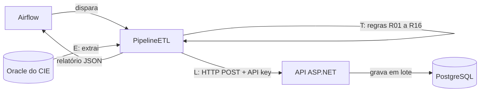

# Pulso 192

Motor de tratamento dos dados de ocorrências do SAMU Recife, feito para o **CIE (Centro de Inteligência Epidemiológica do Recife)**, da SESAU/COP.

Projeto 2 de Segurança da Informação da CESAR School, 2026.2. [Site do projeto](https://sites.google.com/cesar.school/samu-dataflow-projeto-2-ciber/).

## O que faz

Os dados de ocorrências chegam com registros de teste, duplicatas, idades impossíveis, bairros escritos de vários jeitos e campos vazios. O Pulso 192 extrai esses dados do Oracle do CIE, aplica as regras de qualidade e grava o resultado num PostgreSQL, registrando cada execução.



Regras em [docs/regras-de-qualidade.md](docs/regras-de-qualidade.md). Classes em [docs/diagrama-de-classes.md](docs/diagrama-de-classes.md).

## Requisitos

**Funcionais**

1. Extrair as ocorrências do Oracle do CIE
2. Validar os dados com as regras R01 a R16
3. Corrigir, sinalizar ou rejeitar registros inválidos ou duplicados
4. Registrar cada execução (lidos, carregados, rejeitados e motivo)
5. Gravar os dados tratados no PostgreSQL
6. Disponibilizar os dados tratados pela API

**Não funcionais**

- C# / ASP.NET, PostgreSQL, Docker e Airflow
- API protegida por API key
- LGPD: logs não copiam valores dos registros e o endereço fica só como bairro e município

## Estrutura

```
pulso192/              API ASP.NET Core
  Controllers/         endpoints
  Models/              Ocorrencia, Endereco, Sexo
docs/
  regras-de-qualidade.md
  diagrama-de-classes.md
docker-compose.yml     Configurações Docker p/ ambiente de Desenvolvimento
docker-prod-compose.yml     Configurações Docker p/ ambiente de Produção
.env.example           modelo das variáveis de ambiente
```

## Como rodar

### Pré-requisitos:
1. Computador
2. Docker
3. Internet

### Produção
Para iniciar a aplicação **pela primeira vez para produção**:
```bash
docker compose -f docker-prod-compose.yml --env-file <caminho-p-seu.env> up -d --build
```

Para iniciar a aplicação para **demais vezes para produção**:
```bash
docker compose -f docker-prod-compose.yml --env-file <caminho-p-seu.env> up -d
```

### Desenvolvimento
Para iniciar a aplicação **pela primeira vez para produção**:
```bash
docker compose up -d --build
```

Para iniciar a aplicação para **demais vezes para produção**:
```bash
docker compose up -d
```