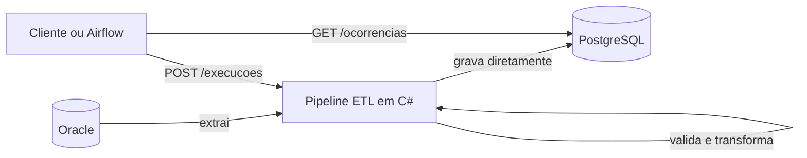

# Pulso 192

Backend para tratamento dos dados de ocorrências do SAMU Recife, feito para o **CIE (Centro de Inteligência Epidemiológica do Recife)**, da SESAU/COP.

Projeto 2 de Segurança da Informação da CESAR School, 2026.2. [Site do projeto](https://sites.google.com/cesar.school/samu-dataflow-projeto-2-ciber/).

## O que faz

O Pulso 192 lê a camada bronze no Oracle, aplica as regras de qualidade e grava os registros aceitos diretamente no PostgreSQL. A API dispara o pipeline e permite consultar os resultados; ela não faz uma chamada HTTP para si mesma durante a carga.



O pipeline registra as rejeições e os totais de cada execução. A persistência usa uma transação e uma chave hash única para não inserir duplicatas em execuções repetidas. Regras em [docs/regras-de-qualidade.md](docs/regras-de-qualidade.md); classes e fluxo em [docs/diagrama-de-classes.md](docs/diagrama-de-classes.md).

## Estrutura

```
pulso192/              API ASP.NET Core e pipeline ETL
  Configuration/       opções de conexão e configuração
  Contracts/           respostas públicas da API
  Controllers/          endpoints /execucoes e /ocorrencias
  Domain/               ocorrência, execução, rejeições e relatório
  Infrastructure/       repositório PostgreSQL e inicialização do schema
  Middleware/           API key e tratamento de erros
  Pipeline/             fonte Oracle, regras e orquestração do ETL
  Database/             schema do PostgreSQL e seed fictício do Oracle
docs/                   regras de qualidade e diagrama de classes
docker-compose.yml      API, PostgreSQL e Oracle de demonstração
.env.example            modelo de variáveis para execução local
```

## Como rodar localmente

### Pré-requisitos

- Docker Desktop com Docker Compose
- Acesso à imagem Oracle Free no Oracle Container Registry

Copie `.env.example` para `.env` na raiz do repositório e ajuste os valores se necessário. Os valores do exemplo são somente para uso local; não use credenciais de exemplo em ambientes reais.

Suba a API e os bancos:

```powershell
docker compose up -d --build
```

Para iniciar novamente sem rebuild:

```powershell
docker compose up -d
```

O Compose publica a API em `http://localhost:8080`, o PostgreSQL em `localhost:5432` e o Oracle em `localhost:1521`. O Oracle verifica a tabela de demonstração no schema `SYSTEM` ao iniciar: se ela não existir com as 36 colunas e 10 registros esperados, executa o script em `Database/Oracle/setup`; caso já esteja pronta, não a recria. Aguarde o Oracle concluir a inicialização antes de disparar o pipeline.

Os endpoints protegidos exigem o header `X-API-Key`. O valor padrão local é `local-only-development-key`; se alterar `API_KEY` no `.env`, atualize também a variável `@apiKey` no arquivo [pulso192.http](pulso192/pulso192.http).
