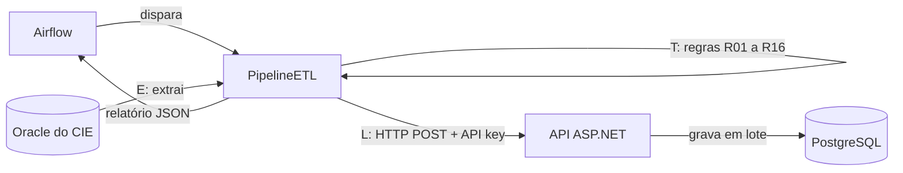

# Pulso 192

Motor de tratamento de dados de ocorrências do SAMU Recife, feito para o **CIE (Centro de Inteligência Epidemiológica do Recife)**, da SESAU/COP.

Projeto 2 do curso de Segurança da Informação da CESAR School, 2026.2. Mais detalhes do problema, do cliente e do processo no [site do projeto](https://sites.google.com/cesar.school/samu-dataflow-projeto-2-ciber/).

## O problema

Os analistas do CIE trabalham com os dados de ocorrências do SAMU, mas esses dados chegam com problemas: registros de teste, duplicatas, idades impossíveis, bairros escritos de vários jeitos e campos vazios. Hoje esse tratamento é manual.

O Pulso 192 automatiza isso no modelo **ETL**: extrai os dados de um banco Oracle preparado pelo CIE, aplica as regras de qualidade e carrega o resultado num PostgreSQL, com registro de cada execução.

## Como funciona



Chegou agora no projeto? Comece por [docs/decisoes.md](docs/decisoes.md): ali está o porquê de cada escolha. Depois as regras em [docs/regras-de-qualidade.md](docs/regras-de-qualidade.md) e as classes em [docs/diagrama-de-classes.md](docs/diagrama-de-classes.md).

## Status

| Parte | Situação |
|---|---|
| Dicionário de dados e regras de qualidade (US03) | Pronto |
| Diagrama de classes completo | Pronto |
| Classes `Ocorrencia`, `Endereco` e `Sexo` | Pronto |
| PostgreSQL e API sobem no Docker (a API ainda não usa o banco) | Pronto |
| Oracle local com os dados de teste | Em andamento |
| Leitura do Oracle (`FonteOracle`) | Em andamento |
| Regras R01 a R04 | Em andamento |
| Carga no PostgreSQL | Em andamento |
| Orquestração no Airflow | Planejado |
| API key | Planejado (antes do primeiro dado real) |
| Regras R05 a R16, relatório de qualidade | Planejado (Sprint 3) |

## Requisitos

**Funcionais.** O sistema deve:

1. Extrair as ocorrências do banco Oracle do CIE
2. Validar os dados com as regras R01 a R16
3. Corrigir, sinalizar ou rejeitar registros inválidos ou duplicados
4. Registrar cada execução (lidos, carregados, rejeitados e por quê)
5. Gravar os dados tratados no PostgreSQL
6. Disponibilizar os dados tratados pela API

**Não funcionais.**

- C# / ASP.NET
- PostgreSQL como banco final
- Docker, orquestrado pelo Airflow
- Acesso à API protegido por API key (sem login de usuário: quem chama é o Airflow)
- LGPD: logs e relatórios não copiam valores dos registros, e o endereço é guardado só como bairro e município

## Estrutura do repositório

```
pulso192/              API ASP.NET Core
  Controllers/         endpoints
  Models/              Ocorrencia, Endereco, Sexo
docs/
  decisoes.md              por que o projeto é assim
  regras-de-qualidade.md   dicionário de dados e regras (US03)
  diagrama-de-classes.md   diagrama completo em Mermaid
docker-compose.yml     PostgreSQL + API
.env.example           modelo das variáveis de ambiente
```

## Como rodar

Pré-requisitos: SDK do .NET 10, Docker e Docker Compose. No Windows, Docker Desktop em modo de contêineres Linux. Todos os comandos na raiz do repositório.

**1. Gere a imagem da API** (o Compose não constrói a imagem, ele espera ela pronta):

```bash
# x64 (Intel/AMD)
dotnet publish pulso192/pulso192.csproj --os linux --arch x64 -t:PublishContainer -p:ContainerRepository=pulso192 -p:ContainerImageTag=latest-linux-x64

# ARM64 (Apple Silicon)
dotnet publish pulso192/pulso192.csproj --os linux --arch arm64 -t:PublishContainer -p:ContainerRepository=pulso192 -p:ContainerImageTag=latest-linux-arm64
```

**2. Crie o `.env`** a partir do modelo e troque as senhas e chaves de exemplo:

```bash
cp .env.example .env            # Linux, macOS, Git Bash
Copy-Item .env.example .env     # PowerShell
```

Em ARM64, mude `API_IMAGE_TAG` para `latest-linux-arm64`. O `.env` nunca vai pro Git.

**3. Suba os serviços:**

```bash
docker compose up -d
docker compose ps
```

PostgreSQL na porta 5433 e API na 8001 (padrão do `.env.example`). Teste: `http://localhost:8001/`.

**4. Pare os serviços** (os dados do PostgreSQL ficam no volume):

```bash
docker compose down
```

## Equipe

| Nome | Papel |
|---|---|
| Luiz Filipe | Product Owner e líder, contato com o cliente, dados e banco |
| Idinaldo | Tech Lead, aplicação C# e API |
| Saulo | SRE, infraestrutura e Docker |
| Ivo | Scrum Master, backlog no Taiga |
| Daniel | Documentação e site |

## Como contribuir

1. Antes de começar, atualize a `main`: `git checkout main && git pull`
2. Crie uma branch por tarefa: `feat/...`, `fix/...` ou `docs/...`
3. Abra um Pull Request para a `main`
4. Todo PR precisa da revisão de outra pessoa do time antes do merge
5. Atualize a tarefa no Taiga
