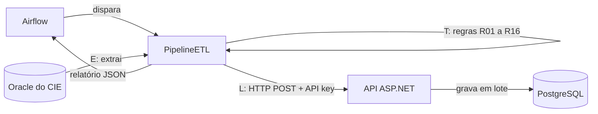

# Pulso 192

Motor de tratamento dos dados de ocorrências do SAMU Recife, feito para o **CIE (Centro de Inteligência Epidemiológica do Recife)**, da SESAU/COP.

Projeto 2 de Segurança da Informação da CESAR School, 2026.2. [Site do projeto](https://sites.google.com/cesar.school/samu-dataflow-projeto-2-ciber/).

## O que faz

Os dados de ocorrências chegam com registros de teste, duplicatas, idades impossíveis, bairros escritos de vários jeitos e campos vazios. O Pulso 192 extrai esses dados do Oracle do CIE, aplica as regras de qualidade e grava o resultado num PostgreSQL, registrando cada execução.



Regras em [docs/regras-de-qualidade.md](docs/regras-de-qualidade.md). Classes em [docs/diagrama-de-classes.md](docs/diagrama-de-classes.md).

## Requisitos

**Funcionais**

1. Extrair as ocorrências do Oracle do CIE
2. Validar os dados com as regras R01 a R16
3. Corrigir, sinalizar ou rejeitar registros inválidos ou duplicados
4. Registrar cada execução (lidos, carregados, rejeitados e motivo)
5. Gravar os dados tratados no PostgreSQL
6. Disponibilizar os dados tratados pela API

**Não funcionais**

- C# / ASP.NET, PostgreSQL, Docker e Airflow
- API protegida por API key
- LGPD: logs não copiam valores dos registros e o endereço fica só como bairro e município

## Estrutura

```
pulso192/              API ASP.NET Core
  Controllers/         endpoints
  Models/              Ocorrencia, Endereco, Sexo
docs/
  regras-de-qualidade.md
  diagrama-de-classes.md
docker-compose.yml     PostgreSQL + API
.env.example           modelo das variáveis de ambiente
```

## Como rodar

Pré-requisitos: .NET 10 SDK, Docker e Docker Compose. Comandos na raiz do repositório.

**1. Gere a imagem da API**

```bash
# x64
dotnet publish pulso192/pulso192.csproj --os linux --arch x64 -t:PublishContainer -p:ContainerRepository=pulso192 -p:ContainerImageTag=latest-linux-x64

# ARM64 (Apple Silicon)
dotnet publish pulso192/pulso192.csproj --os linux --arch arm64 -t:PublishContainer -p:ContainerRepository=pulso192 -p:ContainerImageTag=latest-linux-arm64
```

**2. Crie o `.env`** e troque as senhas de exemplo

```bash
cp .env.example .env            # Linux, macOS, Git Bash
Copy-Item .env.example .env     # PowerShell
```

Em ARM64, mude `API_IMAGE_TAG` para `latest-linux-arm64`.

**3. Suba os serviços**

```bash
docker compose up -d
```

PostgreSQL na porta 5433, API em `http://localhost:8001/`.

**4. Pare os serviços**

```bash
docker compose down
```
