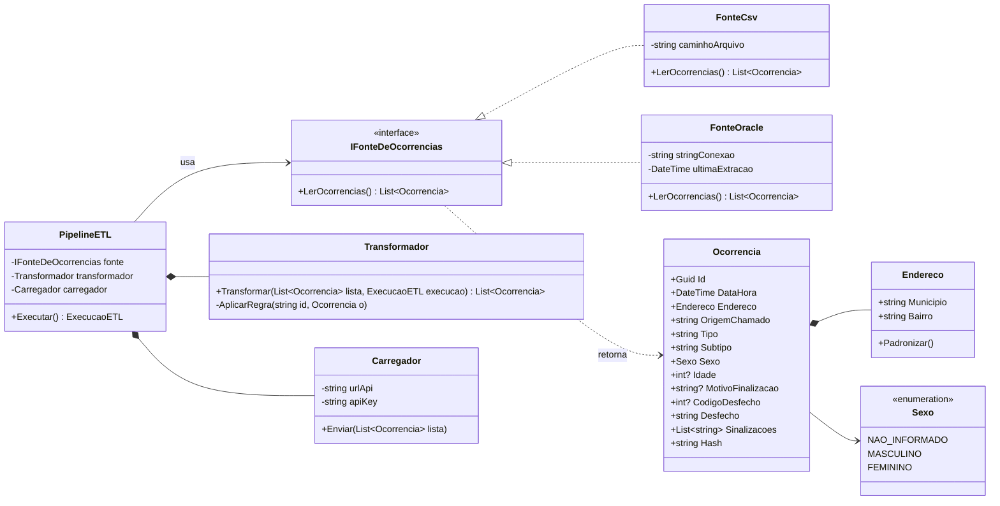
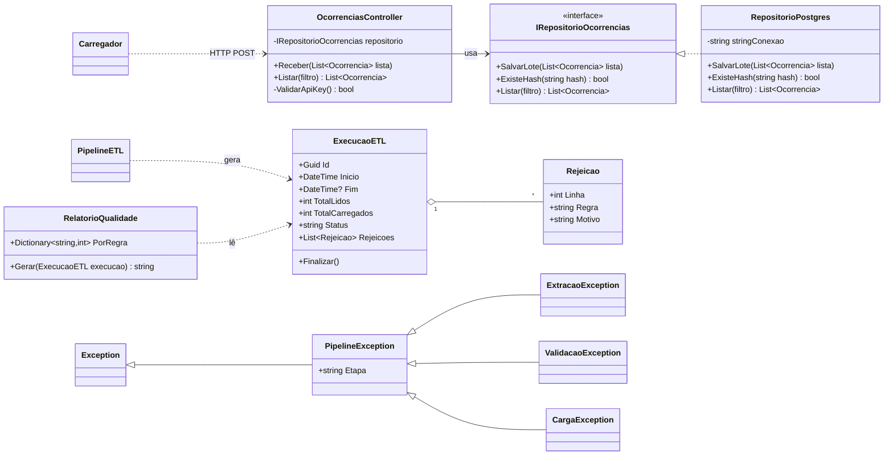

# Diagrama de classes

Versão completa do diagrama apresentado no SR1, com atributos e métodos. Validada com o professor.

O diagrama fica em Mermaid (texto), não em imagem: o GitHub desenha sozinho e qualquer mudança aparece no histórico de commits.

## Parte 1: entrada, domínio e pipeline

## Parte 2: API, auditoria e exceções

## Como ler

| Símbolo | Nome | Significado | Exemplo |
|---|---|---|---|
| `..▷` | Implementação | Cumpre o contrato de uma interface | FonteCsv implementa IFonteDeOcorrencias |
| `—▷` | Herança | É um tipo de outra classe | CargaException é uma PipelineException |
| `—◆` | Composição | A parte não existe sem o todo | Endereco só existe dentro de uma Ocorrencia |
| `—◇` | Agregação | O todo tem partes que fazem sentido sozinhas | ExecucaoETL tem várias Rejeicao |
| `—>` | Associação | Guarda ou usa a outra de forma fixa | OcorrenciasController usa o repositório |
| `..>` | Dependência | Usa a outra só na hora | RelatorioQualidade lê ExecucaoETL |
| `+` / `-` | Público / privado | Quem pode ver | `apiKey` é privado |

## Fluxo de uma execução

1. O Airflow dispara o `PipelineETL.Executar()`. Nasce uma `ExecucaoETL` com status "rodando".
2. A fonte lê (`FonteCsv` em teste, `FonteOracle` em produção). O pipeline não sabe qual.
3. O `Transformador` aplica as regras R01 a R16. O que é recusado vira `Rejeicao`.
4. O `Carregador` manda as ocorrências tratadas por HTTP POST, com a API key, pro `OcorrenciasController`.
5. O controller confere a chave e chama o `RepositorioPostgres`, que descarta duplicatas (`ExisteHash`) e grava em lote.
6. A execução chama `Finalizar()` e o `RelatorioQualidade` gera o JSON que o Airflow mostra.
7. Se algo quebrar, sai uma `PipelineException` (ou filha) dizendo a etapa, e a execução fica com status "falha".

Registro com dado errado **não** gera exceção: isso é das regras (corrige, sinaliza ou rejeita). Exceção é só quando a execução inteira não consegue seguir.
