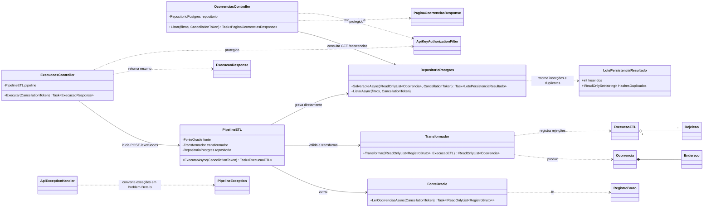

# Diagrama de classes

## Fluxo de uma execução

1. `POST /execucoes` passa pelo filtro de API key e chama `PipelineETL`.
2. `FonteOracle` lê as linhas da tabela de origem e o pipeline contabiliza os registros.
3. `Transformador` aplica as regras de qualidade, produz ocorrências válidas e registra as rejeições.
4. `RepositorioPostgres` grava as ocorrências em uma transação. A restrição única do hash impede a duplicação; hashes já existentes são associados às linhas de origem e contabilizados como rejeições R02.
5. O pipeline finaliza e devolve o resumo da execução. `GET /ocorrencias` consulta diretamente o mesmo repositório PostgreSQL.
6. Erros que impedem a execução são convertidos em respostas HTTP pelo `ApiExceptionHandler`.
